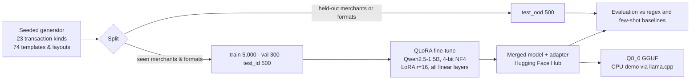

# bank-txn-parser-qlora

[](https://github.com/Tanzil-Ali-Rizvi/bank-txn-parser-qlora/actions/workflows/ci.yml)
[](https://huggingface.co/TARizvi/bank-txn-parser-qwen2.5-1.5b)
[](https://huggingface.co/datasets/TARizvi/indian-bank-txn-parsing)
[](https://kaggle.com/kernels/welcome?src=https://github.com/Tanzil-Ali-Rizvi/bank-txn-parser-qlora/blob/main/notebooks/kaggle_train.ipynb)


**A 1.5B-parameter model fine-tuned with QLoRA on a free GPU that turns Indian bank SMS alerts and statement lines into clean JSON**: direction, amount, channel, counterparty, category, reference, own account, balance and date, across UPI, IMPS, NEFT, RTGS, card, ATM, NACH, cheque and bank entries.

> Every personal-finance app, lender and accounting tool in India has to read these messages, and no two banks write them the same way. The usual answer is a growing pile of regexes plus a merchant lookup table, which works until a new merchant or a new message format arrives. This project measures how far a small fine-tuned model gets past that wall, with an honest held-out test.

## Results

**Exact match** = all 9 fields of a transaction correct. 500 test transactions per column.

| System | Seen formats & merchants | **Unseen merchants or formats** | Prompt size | Latency (T4) |
|---|---|---|---|---|
| Regex + dictionary of every training merchant | 80.0% | 31.8% | – | – |
| Qwen2.5-1.5B-Instruct, untuned, instructions + 4 examples | 17.0% | 17.0% | ~1,000 tokens | 687 ms |
| **Qwen2.5-1.5B + QLoRA (this repo)** | **98.2%** | **72.2%** | **~100 tokens** | **140 ms** |

- **The held-out column is the one that matters.** Every transaction in it has a merchant (33 held out, including Swiggy, Zomato, Myntra and MakeMyTrip) or a message format (13 of 74 templates and layouts) that never appears in training. The regex parser collapses from 80% to 32% there; the fine-tuned model keeps 72%.
- **Category on unseen merchants: 85%** (293 of 343), against 49% for the dictionary. The model uses what it already knows about brands ("Netmeds" is healthcare) rather than a lookup table.
- Fine-tuning also made the prompt about **10× shorter** and inference **5× faster**: the model no longer needs the schema and worked examples spelled out on every call.

Full per-field tables: [`results/RESULTS.md`](results/RESULTS.md). Every prediction from every system is committed in [`results/preds/`](results/preds/), and CI checks that the tables rebuild from them byte for byte.

### Where it still fails (unseen split)

| Slice | Exact match |
|---|---|
| Unseen merchant, familiar format | 82% |
| Unseen format, familiar merchant | 73% |
| Both unseen at once | 49% |

The errors are concentrated, which makes them fixable:

1. **New wording for a known channel.** "Auto-debit (e-mandate)" and "ECS/…" never appear in training. The model labels them `BANK`, or invents channels that are not in the schema (`ECS`, `E-MANDATE`), instead of `NACH` (0 of 28 correct).
2. **A new statement layout.** On the unseen CSV export (`Debit,Credit` columns) it sometimes reads a debit as a credit (34 of 76 exactly right).
3. **Merchant or person?** A few unseen brands paid by UPI (e.g. *Chaayos*) are treated as transfers to a person, and some names lose their last letter (*Chaayo*).

Next steps would be: train on more layout and wording variety (or synthetic paraphrases), constrain decoding to the allowed `channel` and `category` values, and add a small merchant-vs-person signal.

## Example

```text
Input:  Sent Rs.338.42 From Narmada Bank A/C XXXXXX6875 To TATA POWER On 10Dec25 Ref 570315133287 Not You? Call 18001234567
```
```json
{"direction": "debit", "amount": 338.42, "channel": "UPI", "counterparty": "Tata Power", "category": "utilities",
 "reference": "570315133287", "account_last4": "6875", "balance": null, "date": "2025-12-10"}
```

Note what is *not* written in the message: the channel (UPI) and the category (utilities). The model has to know that this SMS template is a UPI alert and that Tata Power is an electricity company.

## How it works



**Data.** [`generate.py`](src/txnparser/generate.py) builds each example from a semantic transaction and then renders it through one SMS template or one statement narration plus layout, in the styles Indian banks actually use (`UPI/DR/412345678901/...`, `NEFT CR-...`, `ACH D- ...`, `POS 4321XXXXXX1234 ...`, Indian number grouping like `1,23,456.00`, a dozen date formats). **The label only contains what the text shows**: if a template has no balance, the answer is `null`, so the model learns not to invent values. Bank names are fictional; merchants are real brands. The dataset regenerates byte for byte from its seed, and CI checks that it does.

**Training.** [`train.py`](src/txnparser/train.py): QLoRA with a 4-bit NF4 base and double quantisation, LoRA r=16 / alpha=32 on all seven linear projections (18.5M trainable parameters, 1.2% of the model), 2 epochs, lr 2e-4, cosine schedule, effective batch 16. Loss is computed **only on the JSON answer**, not the prompt. Plain Hugging Face `Trainer`, so it does not depend on a particular TRL version. **40 minutes on one free Kaggle T4.**

**Baselines.** [`rules.py`](src/txnparser/rules.py) is a regex parser written with full knowledge of the training templates, and given a lookup table of every training merchant: a deliberately strong traditional baseline. The few-shot baseline gets a detailed schema plus 4 worked examples.

**Evaluation.** [`evaluate.py`](src/txnparser/evaluate.py) scores each field with sensible normalisation: amounts within a paisa, counterparty ignoring case, punctuation and `Pvt Ltd`, account numbers by last 4 digits. It also tracks exact match and valid-JSON rate, broken down by message source and transaction kind.

## Reproduce

```bash
pip install -e ".[dev]"
python -m txnparser.generate --out data      # dataset (identical every time)
python -m txnparser.rules                     # regex baseline predictions
python -m txnparser.report                    # rebuild results/RESULTS.md from results/preds/
pytest -q
```

Training, evaluation, publishing and GGUF export run end to end in [`notebooks/kaggle_train.ipynb`](notebooks/kaggle_train.ipynb) (click *Open in Kaggle*, choose a T4 GPU, add an `HF_TOKEN` secret). If you attach a previous run's output, it reuses the trained adapter instead of training again.

Use the published model:

```python
from transformers import AutoModelForCausalLM, AutoTokenizer
repo = "TARizvi/bank-txn-parser-qwen2.5-1.5b"
tok = AutoTokenizer.from_pretrained(repo)
model = AutoModelForCausalLM.from_pretrained(repo, torch_dtype="auto", device_map="auto")
msgs = [{"role": "system", "content": "Parse this Indian bank transaction into JSON."},
        {"role": "user", "content": "Transaction:\nRs.450.00 debited from A/c XX1234 on 12-10-26 to VPA swiggy@icici (UPI Ref No 412345678901)."}]
ids = tok.apply_chat_template(msgs, add_generation_prompt=True, return_tensors="pt").to(model.device)
print(tok.decode(model.generate(ids, max_new_tokens=192, do_sample=False)[0, ids.shape[1]:], skip_special_tokens=True))
```

## Repository layout

```
src/txnparser/
  catalog.py     merchants, institutions, names, fictional banks
  generate.py    seeded dataset generator with in-distribution and held-out splits
  schema.py      output schema, prompts, robust JSON parsing
  rules.py       regex + dictionary baseline
  train.py       QLoRA fine-tuning (prompt-masked loss)
  infer.py       batched inference for base (few-shot) and fine-tuned models
  evaluate.py    field-level scoring
  report.py      comparison tables -> results/
  publish_hf.py  model card, dataset card and Hub upload
  gguf_eval.py   checks the 8-bit GGUF against the fp16 model
demo/            Streamlit app: fine-tuned model (GGUF, CPU) next to the regex baseline
notebooks/       Kaggle notebook that runs the whole experiment
results/         metrics, tables and every system's predictions
```

CI runs on every push: lint and tests on Python 3.10–3.12, a check that the dataset regenerates and the results tables rebuild exactly, a CPU smoke test of training and inference with a tiny random model, and a secret scan.

## Limitations

- The data is synthetic. It imitates common Indian bank formats but real banks vary more, so check accuracy on your own messages before relying on it.
- The held-out test is held out *by construction* (merchants and templates); it is not a sample of real-world traffic.
- For anything that moves money, treat the output as a pre-fill that a rule or a person confirms, not as the source of truth.

## License

Apache-2.0 © 2026 Tanzil Ali Rizvi. Base model: [Qwen2.5-1.5B-Instruct](https://huggingface.co/Qwen/Qwen2.5-1.5B-Instruct) (Apache-2.0).
